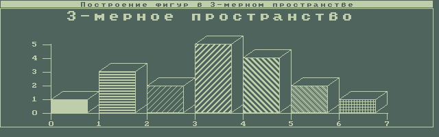
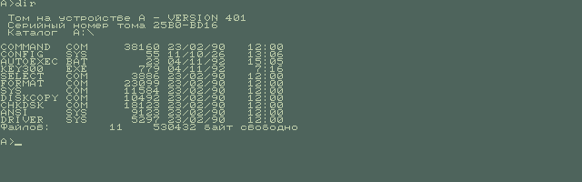
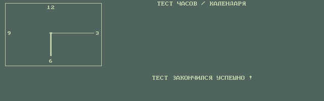

# Elektronika MS 1504 in MAME

A MAME driver for the Elektronika MS 1504 (PK-300), the Soviet laptop made by
NPO Integral in Minsk from 1991, a PC/XT compatible modelled on the Toshiba
T1100 Plus. It runs the original BIOS and boots the machine's own software:
Integral's installer, demo and factory tests, and the Russian MS-DOS 4.01 it
was sold with.

No ROM or disk image is included here. `docs/reproducing.md` says where each
one comes from.

## What works

- The 28/06/90 BIOS ("MINSK.....PC300") and the later 18/02/93 one with XTA
  hard disk support, as two BIOS options.
- The LCD controller: CGA registers plus the 4 KB character generator RAM
  that the BIOS fills through port 3DFh, with its two 8x8 Cyrillic fonts and
  the three code pages it can load (GOST "basic", CP866, CP437). The LCD is
  drawn in two tones, with intensity shown in the thick font; an external
  RGB monitor is a configuration option.
- The MC146818 compatible clock at 70h/71h. Integral's own clock test passes.
- The 4.77/7.16 MHz clock switch at port E0h.
- Two 3.5" 720 KB drives, the serial and parallel ports.
- The keyboard, written from the BIOS translation tables: Soviet typewriter
  number row, Rus/Lat lock and held keys, SysReq, F11 and F12.
- Integral's MS-DOS 4.01R installer (disk 0, SETUP and DISK300) installs the
  system end to end, swapping disks as it asks.

## What does not

- The keyboard microcontroller (KR1835VE49) is not dumped, so the keyboard
  is high level.
- No XTA hard disk, IOLA network adapter or external 5.25" drive.
- The LCD tones and the 19:10 aspect come from a photograph.
- Which value of port E0h is the fast clock is inferred from the BIOS
  hot keys, not measured.

## Layout

    driver/     the machine, its LCD controller and keyboard
    patches/    the MAME driver list entry, and skip_warnings in ui.ini
    tools/      build, headless run, the Lua action runner, disk tools
    docs/       hardware map, findings, how to reproduce

## Building

Against MAME 0.289 (tag mame0289):

    MAME_TREE=/path/to/mame tools/build.sh

`tools/build-windows.sh` does the same with MSYS2. Details in
`docs/reproducing.md`.

Nothing here has been sent upstream.

## Licence

BSD-3-Clause, the same as MAME. See `LICENSE`.
